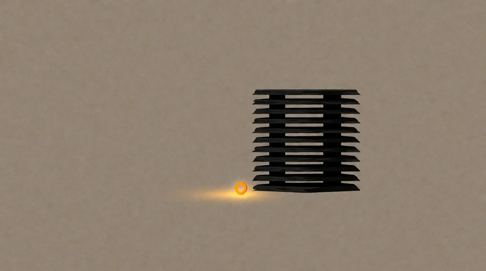

# Bullshit Bingo

*The diagrams flooding your feed are not explanations. They are ads.*

<!-- mb:block preset=byline -->
*by David A. Renelt (Human) and DeepSeek V4 Pro (AI)*

Published October 18, 2026
<!-- mb:/block -->

<!-- mb:block preset=player kind=audio -->
[Listen to this article](tts/bullshit-bingo_2026-10-18.mp3)
<!-- mb:/block -->

<!-- mb:block preset=image:hero kind=image -->

<!-- mb:/block -->

The feed is full of them now — the AI architecture diagram, the agent roadmap, the nine-layer stack, scrolling past like weather — and somewhere in the last month I stopped scrolling past them and started saving them. Fifty-seven so far, not to learn from, since I stopped expecting that around the tenth, but to see what the genre looks like when you pin fifty-seven of its specimens to a board. The saving was mine; the reading was the machine's. A vision model transcribed every chart word for word, checked the links, looked up every named tool, and wrote a verdict from the artifact rather than from my annoyance, after which a second, unframed model re-read the first sixteen images to keep my framing honest.

## Not wrong — misleading

What came back kept the exercise honest, because most of these charts are factually defensible: the vendor tools exist, the steps correspond at a squint to real practice, and if you charge any single poster with lying, the charge mostly won't stick. Where they mislead is the framing — implied sequence where none is required, implied difficulty where five boxes of a nine-step ladder are a single API call, implied completeness ("the only blueprint you'll ever need") that always seems to terminate, if you follow the arrows to the bottom corner, in a funnel. The content is fine; the shape is the product.

And because the shape has to look architectural even when the thought underneath is thin, the same four grammar moves recur so reliably they became my bingo squares: **the unnamed load-bearing partition**, where a box labelled *intelligent router* carries a real decision with no stated criterion; **the reassurance panel**, a checkmark list that restates its own title across a fifth of the canvas; **expertise as tooling breadth**, like an iceberg chart that labels nineteen logos below the waterline "Experts" without a single evaluation framework among them; and **the timeframe-free claim**, promising "10–100x cheaper" against no baseline, on no date, in no version.

## The mechanism is small

The charts need those moves because what they dress in nine layers is embarrassingly small: a model that reads, tools it can call, data it can reach, and a loop that runs until the job is done. That is the entire machine under every chart in my collection. The rest is coats.

And there are only two ways to stand in front of that machine: you can specify every box, every arrow, and the whole governance wheel, or you can hand it the data and tell it the outcome you are after. Because the first posture produces a diagram while the second produces nothing to post at all, the feed only ever shows you the first — which is worth remembering when the feed starts to look like a consensus. We ran this play with cloud, selling solutions ten sizes too large for the problem, though cloud at least had real machinery failing at three in the morning; here the tool explains its own use, so the complication has to be built out of words.

## The wrong problem

At first I assumed someone was deciding what to leave off the slide, until the transcriptions made it obvious that nobody has to decide: the charts are not hiding the hard problems; the hard problems cannot be drawn. Cost doesn't render, because cost is a distribution over time under failure, and a diagram shows a single happy path. Hostile input doesn't render, because the space of attacks is not a node — it is the negative space every node sits in. The checker doesn't render, because it lives outside the system being drawn: a diagram *is* the system, and verification is the relation between the system and the world that has to live with it.

That is why Harry Frankfurt's *On Bullshit* is only half the diagnosis. Frankfurt separates the liar, who knows the truth and bends it, from the bullshitter, who is merely indifferent to it — and at the level of the boxes, that fits: everything that boxes neatly makes it onto the canvas, and everything that keeps those boxes honest stays off it, not out of malice, but because the medium has no way to ask for it. Even the better later arrivals in my pile come from self-taught practitioners who drew their own toolbag, discovered the drawing sells, and kept drawing.

Yet Frankfurt's innocence only covers the facts inside the boxes; it does not cover the authority posture of the person holding the pointer. The poster's real move is *"I know something — here is how it all works,"* the stance of surveyed knowledge, when the substance delivered is thin and the hard parts aren't even in the room. That is where the grift lives: not in lying about the tools, but in selling the appearance of mastery when there is almost nothing to master on the slide, and whether the seller is conscious of the gap is beside the point. Frankfurt covers the facts; the grift covers the authority. And between the two of them, you get fifty-seven charts of how AI systems work, factually defensible, **and they don't help with anything**, because the mechanism they diagram fits in a sentence and the work that matters cannot be drawn.

## The framework trap

Follow the arrows far enough down the funnel and the diagram solidifies into a framework — the same limit, one scale up, made executable. What you adopt is not a tool but somebody else's idea of order, sold as Developer Experience, while the real cost stays off the slide: your process doesn't need ninety percent of what you just installed, and the abstraction that was going to save you time becomes the thing you debug. After three decades of watching software fashions arrive, ossify, and quietly die, I have seen entire business trees get infected with the idea that their problems were hard, when what was actually hard was making their problem fit the framework. The difficulty was real. The difficulty was the installation.

And what the diagram cannot admit is that the prompt has quietly dissolved its excuse: glue code is cheap now. A custom solution built for your data and your failure modes — instead of every problem the framework anticipated — is an afternoon, not a procurement, and it can be improved and maintained at the speed of tokens, with no mindset tax on code that is entirely yours.

## The skill the industry actually needs

So what would helping look like? Not stack literacy, and certainly not another governance wheel, but planning — looking at the specific problem, designing the smallest integration that solves it honestly, and knowing where it can fail and what failure costs. Because the machine is learning us faster than we have to learn it, the durable skill is wanting something sharply enough to see its edges and saying so precisely; the rest is a plan, and the plan is short when the problem is understood, which is the bet behind a lecture series I have been building all season.

You cannot certify that, which is why the cards never mention it — so I won't end the way they end, with a download and a funnel. Here is the card instead, from play: *a box labelled intelligent. A checkmark restating its title. Nineteen logos and no evals. A multiple with no baseline. Safety as step eight.* Tick the squares. Then put the card down and go plan the small thing that actually solves yours.

---

### Sources

- The corpus: 57 LinkedIn AI-architecture charts (October 2026, ongoing), transcribed verbatim with per-piece verdicts, a frequency ledger, and an absence table — [research notes: the competence-grift corpus](../references/competence-grift-corpus.md).
- Second-pass verification: the first sixteen source images re-read by an unframed vision model (2026-10-11); discrepancies logged, none verdict-changing.
- Harry Frankfurt, *On Bullshit* (Princeton University Press, 2005; essay 1986).

*Written in a working session between a human and the machine, like everything here. The corpus, transcriptions, and verdicts are on file.*
