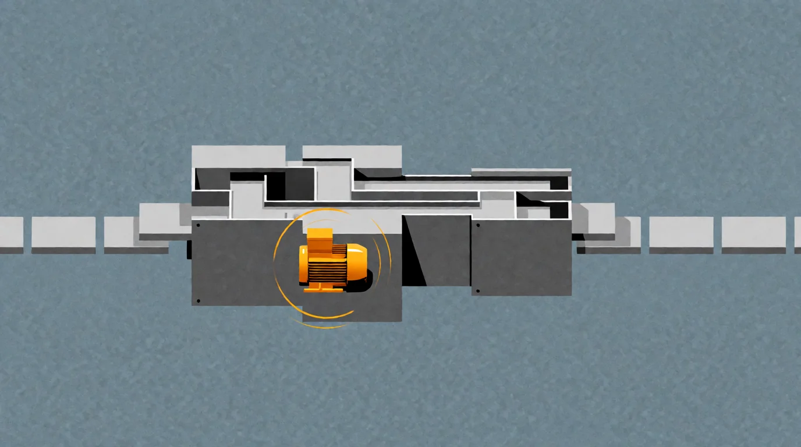
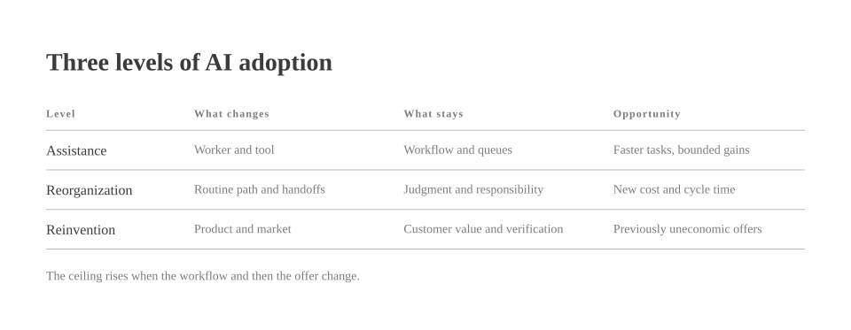
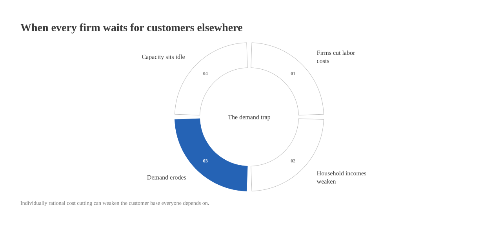

# The 1.2x Trap

*by David A. Renelt (Human) and Kimi K3.1 Pro (AI)*

<!-- mb:block preset=player kind=audio -->
[Listen to this article](tts/the-1-2x-trap_2026-11-08.mp3)
<!-- mb:/block -->

<!-- mb:block preset=image:hero kind=image -->

<!-- mb:/block -->

Every company now has an AI strategy. In a reassuring number of cases, it turns out to be the old company with a new subscription.

The meetings survive, though a bot now takes the minutes nobody reads. The weekly reports survive, though a model now drafts the prose nobody wanted to write. The approval chain remains intact, except that documents now arrive at each desk at terrific speed and bristling with em dashes. Everyone agrees that AI changes how we work, right before we hire, organize, manage, and measure success in the exact way we did on Tuesday.

This is not nothing; a useful tool is a useful tool. Still, it is a peculiar response to a supposedly general transformation. We leave the org chart untouched and rent a little synthetic intelligence to help it cope with its own paperwork.

The bills for this arrangement arrive promptly: seat licenses, integration work, evaluations, human supervision, and a fresh dependency on whichever vendor owns the weights. The returns are harder to corner. Mostly they appear as twenty minutes rescued here and a less painful first draft there. Saved time is pleasant for the person who saves it, of course, yet it only becomes business value when it alters output, quality, speed, staffing, or what the customer actually receives.

**If every AI output still enters the same human queue, cheaper inference merely makes it cheaper to feed the queue.**

## The kindness of 1.2x

It is easy to blame executive cowardice or the stubbornness of middle management, mostly because blaming middle management is a cherished corporate pastime. It is also unfair. No decent leader is eager to turn a software rollout into a layoff program, and starting with copilots lets an organization learn the terrain without betting the firm on a technology whose failure modes remain creative and poorly understood.

Besides, managers do much more than route messages. They coach, set priorities, adjudicate turf wars, and carry the blame when things go sideways. Where the trouble starts is the narrower slice of management that consists of collecting status, boiling it down, and forwarding it upstairs. An LLM can write that update. The awkward question is why the update needs to exist at all.

You cannot politely ask people to re-engineer themselves out of a livelihood unless you offer them somewhere better to go and a cut of the upside. What looks from a distance like a failure of imagination is often just a sober reading of the incentives.

**The mistake is not starting with copilots. It is setting up camp there.**

## Do not automate the org chart

Think of [three levels of AI adoption](../references/ai-workflow-redesign.md). The first is assistance, which makes the current worker faster at the current job. The second is reorganization, where the routine path becomes machine-first and humans reserve their attention for judgment calls and strange exceptions. The third is reinvention, which changes what the firm can plausibly sell: continuous service, genuine personalization, or work that used to be too labor-intensive to bother quoting.

<!-- mb:block preset=image kind=image -->

<!-- mb:/block -->

Assistance hits a ceiling quickly because all the surrounding bottlenecks stay on the calendar. The larger opportunity sits at the next two levels, and they are uncomfortable precisely because they unsettle arrangements rather than individual tasks. They force a company to ask how many of its handoffs, sign-offs, job descriptions, and product boundaries are really just monuments to the historical price of human attention.

Even then, redesign runs into a hard gate. Checking the machine's work has to cost less than doing the work by hand, unless the jump in quality is big enough to pay the difference. Model reliability is only half the problem; legal liability and professional duty are the other half. The working rule is to **preserve the function and challenge the form**. Skip the first part and you trade a slow bureaucracy for a very fast, very sleek accident.

Still, caution inside the building does not freeze the market outside it. Wherever an industry remains contestable, an AI-native newcomer can show up offering comparable value on an unrecognizable cost curve. Incumbents have moats, naturally, though a moat is not a law of physics. The real danger to a cautious workforce is not that a model replaces employees one desk at a time, but that a differently wired competitor replaces the whole company at once.

**Sparing the org chart from internal disruption is a reliable way to invite a larger disruption from across the street.**

## The uplifted market

Talk of tenfold growth should be taken as a provocation rather than a spreadsheet forecast. Its use is to force the question of which customers and services come into reach once old cost constraints give way. Even so, sheer output is only inventory until somebody can pay for it.

One firm can automate its workflows and expand capacity. An entire economy of firms doing the same thing can turn out a heroic volume of goods and services. If household purchasing power concentrates or erodes while they do it, all that gleaming new supply simply arrives in a market full of people who are broke.

Falling prices can stretch a paycheck, and new kinds of work do emerge, yet neither effect is automatic. A person without an income does not become a thriving consumer just because an automated service gets cheaper.

**Supply-side transformation without demand-side transformation is an elaborate way to saw off the branch you are sitting on.**

No single executive can fix that alone by paying high wages and hoping competitors return the favor. Because every firm wants lean costs for itself and flush customers from everyone else, we are looking at a classic collective-action problem—one that business and politics can only solve in tandem.

<!-- mb:block preset=image kind=image -->

<!-- mb:/block -->

On the business side, the job is to turn capability into better products, broader service, lower prices, new markets, and credible ways for workers to share in the gains. On the political side, the job is to keep markets competitive, infrastructure accessible, and purchasing power broad, while updating income and ownership arrangements so they still work when the demand for human labor shifts.

Put those halves together and you get an [uplifted market](../references/the-uplifted-market.md): rising output matched by rising purchasing power, each giving the other room to grow. For executives, widespread prosperity is not charity; it is the demand side of the business plan. For policymakers, productive redesign is what pays the bill for a more generous society.

So do not merely automate the org chart. Rebuild the enterprise around what the technology can actually do, help build the market that can afford to buy it—and once the machinery works, ask the larger question of what all that newly freed capacity should be for, which we take up in [Why the Fuck Not?](why-the-fuck-not.md).
