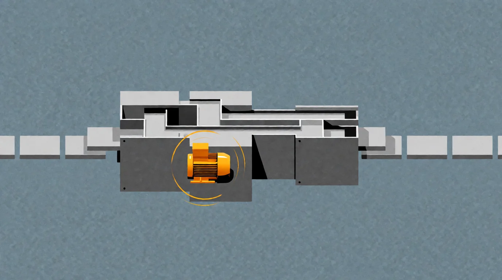
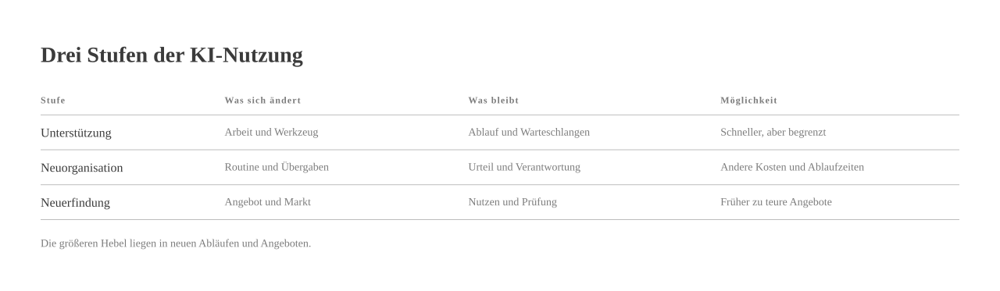
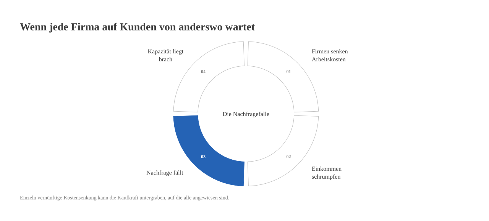

# Die 1,2-fach-Falle

*by David A. Renelt (Human) and Kimi K3.1 Pro (AI)*

<!-- mb:block preset=player kind=audio -->
[Diesen Artikel anhören](tts/the-1-2x-trap_de_2026-11-08.mp3)
<!-- mb:/block -->

<!-- mb:block preset=image:hero kind=image -->

<!-- mb:/block -->

Praktisch jedes Unternehmen hat inzwischen eine KI-Strategie. Überraschend oft besteht sie darin, dass das alte Unternehmen ein neues Softwareabonnement hat.

Die Besprechungen finden weiter statt, nur schreibt jetzt ein Programm die Protokolle, die vermutlich auch künftig kaum jemand liest. Die regelmäßigen Berichte bleiben, aber ein Sprachmodell übernimmt den Text, den vorher schon niemand gern verfasst hat. Selbst die Genehmigungskette steht noch; die Dokumente rutschen lediglich schneller durch die Abteilungen und enthalten unterwegs auffällig viele Gedankenstriche. Alle sind sich einig, dass künstliche Intelligenz die Arbeit von Grund auf verändert. Am Montagmorgen wird dann exakt so eingestellt, organisiert, verwaltet und gemessen wie zuvor.

Nichts gegen nützliche Werkzeuge. Ein Entwurf, der nicht vor einem leeren Blatt beginnt, spart Nerven, und ein paar gewonnene Minuten sind ein ehrlicher Gewinn. Merkwürdig ist nur das Missverhältnis: Man holt sich eine angeblich umwälzende Technologie ins Haus, lässt das Organigramm unangetastet und nutzt die zusätzliche Rechenleistung vor allem dazu, dessen Papierkram geschmeidiger abzuwickeln.

Die Rechnung ist durchaus real: Lizenzen, die Einbindung in bestehende Systeme, die Prüfung der Ergebnisse, menschliche Aufsicht und eine neue Abhängigkeit von einem Anbieter. Auf der anderen Seite stehen ein leichterer erster Aufschlag und ein paar gerettete Viertelstunden. Gesparte Zeit wird aber erst dann zu geschäftlichem Wert, wenn sich dadurch die Produktion, die Qualität, das Tempo, der Personalbedarf oder das Ergebnis für die Kunden verändert.

**Solange jedes KI-Ergebnis wieder in derselben menschlichen Warteschlange landet, macht billigere Rechenleistung nur das Auffüllen dieser Warteschlange billiger.**

## Warum der kleine Gewinn so bequem ist

An dieser Stelle gibt man gern feigen Vorständen oder dem notorisch sturen mittleren Management die Schuld. Das mittlere Management ist schließlich der beliebteste Sandsack der modernen Bürokritik, gleich nach dem Großraumbüro. Die Erklärung ist nur leider zu bequem.

Verantwortungsvolle Führungskräfte haben gute Gründe, aus einer Softwareeinführung nicht sofort ein Entlassungsprogramm zu machen. Mit KI-Assistenten anzufangen ist vernünftig: Eine Organisation lernt das Werkzeug im Alltag kennen, ohne gleich das ganze Haus auf eine Technik zu setzen, deren Fehlerarten noch nicht gut genug verstanden sind.

Gute Manager tragen außerdem mehr als Informationen von links nach rechts. Sie halten Leuten den Rücken frei, setzen Prioritäten, schlichten Konflikte und stehen gerade, wenn etwas schiefläuft. Etwas anderes ist der Teil ihrer Arbeit, der Statusmeldungen einsammelt, glattzieht und eine Etage höher abgibt. Ein Sprachmodell kann solche Zusammenfassungen schreiben. Die interessantere Frage lautet deshalb nicht, wie der Bericht schneller entsteht, sondern warum ihn überhaupt noch jemand braucht.

Nur wird kaum jemand gern die eigene Stelle wegrationalisieren, solange niemand eine neue Aufgabe und einen fairen Anteil am Gewinn anbietet. Was in Strategiepapieren als mangelnde Vorstellungskraft gilt, ist im Büroalltag oft nur ein nüchterner Blick auf die tatsächlichen Anreize.

**Der Fehler besteht nicht darin, mit Assistenten zu beginnen. Der Fehler besteht darin, sich nach den ersten kleinen Gewinnen häuslich einzurichten.**

## Nicht das Organigramm automatisieren

Wer sehen will, wo die eigentliche Musik spielt, kann drei Stufen unterscheiden:

1. **Unterstützung:** Ein Mensch erledigt die bisherige Aufgabe mit einem besseren Werkzeug schneller. Abläufe und Warteschlangen bleiben dieselben. Der Nutzen ist echt, aber durch das bestehende System begrenzt.
2. **Neuorganisation:** Der normale Durchlauf wird maschinell erledigt, während Menschen sich um Urteilsfragen, Ausnahmen und Verantwortung kümmern. Dadurch können sich Kosten und Durchlaufzeiten deutlich verändern.
3. **Neuerfindung:** Das Angebot selbst verändert sich. Möglich werden etwa fortlaufende Betreuung, echte Einzelanfertigung oder Leistungen, die früher an den Kosten menschlicher Arbeitszeit scheiterten.

<!-- mb:block preset=image kind=image -->

<!-- mb:/block -->

Die erste Stufe hat eine niedrige Decke, weil ringsherum alle alten Engpässe stehen bleiben. Die beiden anderen bieten die größeren Hebel, sind aber ungemütlicher. Sie verändern nicht bloß einzelne Handgriffe, sondern Absprachen, Zuständigkeiten und Hausmacht. Wer dorthin will, muss fragen, welche Übergaben, Freigaben, Rollen und Produktgrenzen eigentlich nur deshalb existieren, weil menschliche Aufmerksamkeit bisher so knapp und teuer war.

Dabei bleibt eine harte wirtschaftliche Bedingung: Die Prüfung der maschinellen Arbeit muss weniger kosten als ihre frühere Herstellung durch Menschen – es sei denn, ein messbarer Qualitätsgewinn rechtfertigt den Aufpreis. Technische Zuverlässigkeit ist dabei das eine Problem, Haftung und berufliche Verantwortung das andere.

Mancher umständliche Bericht und manche zähe Freigabe haben eine echte Schutzfunktion. Die vernünftige Regel lautet deshalb: **Funktion bewahren, Form hinterfragen.** Wer einfach nur den Rotstift ansetzt, ersetzt eine schwerfällige Sicherung leicht durch einen sehr eleganten Unfall.

Allerdings hält die eigene Vorsicht draußen niemanden auf. Wenn ein Markt für neue Anbieter offen ist, kann ein von Grund auf um KI herum gebauter Wettbewerber denselben Nutzen mit einer völlig anderen Kostenstruktur liefern. Etablierte Firmen besitzen zwar Burggräben – Marken, Vertriebswege, Datenbestände, regulatorische Hürden –, aber kein Burggraben ist ein Naturgesetz.

Die Beschäftigungsgefahr besteht deshalb nicht nur darin, dass KI einzelne Angestellte ersetzt. Sie besteht auch darin, dass ein anders organisiertes Unternehmen das bisherige Unternehmen als Ganzes verdrängt.

**Wer im eigenen Haus jede Veränderung vermeidet, lädt die größere Veränderung durch die Konkurrenz förmlich ein.**

## Produktion und Kaufkraft müssen zusammenwachsen

Reden wir also nicht über kleine Verbesserungen, sondern über den Faktor zehn. Diese Verzehnfachung ist keine Prognose aus einer Tabellenkalkulation, sondern eine Suchfrage: Welche Kunden und welche Leistungen rücken in Reichweite, wenn die alte Kostenbeschränkung fällt?

Mehr Produktion ist noch kein Wachstum, solange niemand die Ergebnisse bezahlen kann. Was niemand kauft, bleibt am Ende Lagerbestand – oder einfach ungenutzte Kapazität.

Ein einzelner Betrieb kann automatisieren und sehr viel mehr herstellen; eine ganze Volkswirtschaft kann das ebenfalls. Wenn sich gleichzeitig Einkommen und Kaufkraft bei wenigen konzentrieren oder für viele schrumpfen, trifft das glänzende neue Angebot auf Menschen ohne Geld. Sinkende Preise können die reale Kaufkraft erhöhen, und neue Aufgaben und Berufe können entstehen. Beides ist möglich, aber nichts davon ist garantiert. Wer kein Einkommen hat, wird nicht allein dadurch zahlungskräftig, dass eine automatisierte Dienstleistung billiger wird.

**Ein Umbau nur auf der Angebotsseite ohne einen Umbau auf der Nachfrageseite sägt an dem Ast, auf dem die ganze Veranstaltung sitzt.**

Kein einzelnes Unternehmen kann dieses Dilemma lösen, indem es darauf hofft, dass schon alle anderen Firmen die Löhne seiner künftigen Kundschaft zahlen werden. Jedes Unternehmen wünscht sich im eigenen Haus niedrige Kosten und braucht zugleich draußen gut verdienende Haushalte. Einzeln ist das vernünftig; gemeinsam kann es in die Hose gehen. Genau deshalb kommen Wirtschaft und Politik hier nicht ohneeinander aus.

<!-- mb:block preset=image kind=image -->

<!-- mb:/block -->

Auf der Seite der Unternehmen heißt das: bessere Produkte und Dienstleistungen entwickeln, Kosten und Preise senken, neue Märkte und bisher unbezahlbare Angebote erschließen – und die eigenen Beschäftigten glaubwürdig an den Produktivitätsgewinnen beteiligen. Auf der Seite der Politik heißt es: Wettbewerb und den offenen Zugang zur Infrastruktur sichern, breite Kaufkraft schützen und Einkommens- sowie Eigentumsordnungen so weiterbauen, dass sie auch dann noch tragen, wenn sich die Nachfrage nach menschlicher Arbeit verändert.

Das Ziel ist ein Markt mit Rückenwind, in dem Produktion und Kaufkraft gemeinsam wachsen und sich gegenseitig Spielraum verschaffen. Für Unternehmen ist breiter Wohlstand kein wohltätiges Beiprogramm, sondern schlicht die Nachfrageseite ihrer eigenen Wachstumsstrategie. Für die Politik ist der produktive Sprung die Grundlage, aus der sich bessere gesellschaftliche Möglichkeiten überhaupt erst finanzieren lassen.

Man sollte also nicht das alte Organigramm automatisieren. Man sollte das Unternehmen um die neuen Fähigkeiten herum neu aufbauen – und zugleich an dem Markt mitarbeiten, der sich die Ergebnisse am Ende auch leisten kann. Womit wir bei der eigentlich spannenden Anschlussfrage wären: Wofür wollen wir diese neu gewonnene Leistungsfähigkeit als Gesellschaft überhaupt einsetzen? Unsere Antwort darauf steht in [Why the Fuck Not?](why-the-fuck-not_de.md): mehr Gleichheit, Lebensqualität, Gesundheit und Freiheit.
