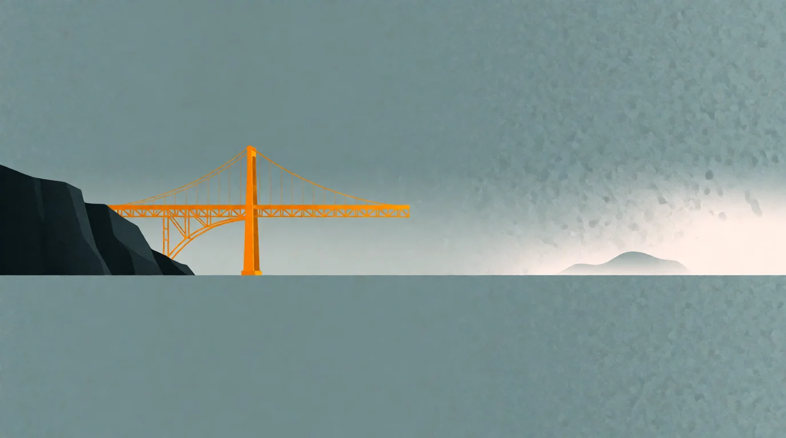

# Die Antwort vor der Frage

*by David A. Renelt (Human) and Kimi K3.1 Pro (AI)*

<!-- mb:block preset=player kind=audio -->
[Diesen Artikel anhören](tts/the-answer-before-the-question_de_2026-10-31.mp3)
<!-- mb:/block -->

<!-- mb:block preset=image:hero kind=image -->

<!-- mb:/block -->

Mit dem seltsamsten Ereignis meines Lebens ist etwas Eigenartiges passiert: Es ist gewöhnlich geworden.

Als [AlphaGo](../references/alphago_de.md) die besten Go-Spieler schlug, zuckte die Welt mit den Schultern. Es war ein Brettspiel, und Computer waren eben gut in Spielen; kaum jemand wusste, welche Art von Nachricht er da eigentlich las. Als die Sprachmodelle kamen, galten sie erst als plappernde Papageien oder schick verpackte Autovervollständigung. Intellektuelle stritten, ob das wirklich Denken sei, und viele waren sich angenehm sicher: natürlich nicht. Dann kam die Sicherheitsdebatte, und die Frage verschob sich unbemerkt: nicht mehr, ob die Maschine denkt, sondern ob sie uns umbringen will.

Wenige Monate später war auch das Hintergrundrauschen. Dieselben Kreise, die einst das Internet als Verdummungsmaschine entlarvt hatten, warnten nun vor KI, Politiker zeigten auf China und Russland, und Menschen ohne jedes Interesse an Philosophie fragten einen Chatbot, was sie zum Abendessen kochen sollten.

Das Gespräch dazwischen fiel aus: Was bedeutet es für uns, etwas zu bauen, das genau jene Fähigkeit teilt, auf die wir unsere Sonderstellung gegründet hatten? Die Technik zog ein; ihre Bedeutung blieb vor der Tür.

Nun wird jede erfolgreiche Technik irgendwann zu Möbeln. Internet, Smartphone, Fernsehen und Comics begannen jeweils als Gefahr für die Jugend und endeten als Einrichtung. Panik wirkt im Rückblick wie das kleine Pflichtritual vor dem Weitermachen. Das spricht gegen blinde Aufregung, beweist aber keine Entwarnung: Auch nach hundert Fehlalarmen kann beim nächsten Mal tatsächlich ein Haus brennen.

Mich stört an der aktuellen Panik eher, wie bequem klein sie ist. Arbeitsplätze, faule Kinder, bessere Waffen für feindliche Regierungen – das sind ernste, aber vertraute Sorgen. Sie erlauben uns, über Reparaturen an der bestehenden Welt zu reden, ohne zu fragen, wozu diese Welt eigentlich gut sein soll.

## Das Ende einer nützlichen Ausrede

Vor dieser Frage schützte uns lange ein schlichter Satz: Wir können nicht. Nicht alle ernähren, keine gerechte Gesellschaft schaffen, das Altern nicht stoppen, nicht jede Krankheit heilen, nicht jeden Schaden beheben. Das Unvermögen begrenzte uns nicht nur, es entschuldigte uns auch. Es machte den Abstand zwischen unseren verkündeten Werten und unserem Handeln erträglich.

KI rüttelt an dieser Ausrede. Niemand muss glauben, dass ein Software-Abo automatisch die Welt erlöst. Aber wenn maschinelle Intelligenz zu einem allgemeinen Werkzeug für Problemlösungen wird, wandern manche Dinge womöglich aus der Abteilung „Unmöglich“ in die Abteilung „Entscheidung“.

Dann wird es ungemütlich. Was verrät es über uns, wenn Hunger beseitigbar wäre und wir ihn trotzdem lassen? Wenn Institutionen gerechter sein könnten, wir aber die Ungerechtigkeit vorziehen? Wenn Alterung behandelbar würde, wir aber zögern, weil unsere Ordnung stillschweigend darauf baut, dass Menschen rechtzeitig verschwinden?

Und selbst der Erfolg hilft uns nicht aus der Patsche. Was macht eine Zivilisation, wenn Überleben, Mangel und langsamer Verfall wegfallen – all das also, was bisher fertige Ziele geliefert hat, ohne dass jemand nachdenken musste? Ob wir scheitern oder siegen: Am Ende wartet dieselbe Frage nach dem Wozu.

## Die ausgelassene Wirklichkeit

Unsere mechanistische Weltsicht ist für diese Frage schlecht gerüstet, gerade weil sie so erfolgreich ist. Sie zerlegt Probleme, findet Ursachen, dreht an Stellschrauben. Wir verdanken ihr Medizin, Hygiene und den Abschied vom Kerzenlicht als Alltagsbeleuchtung. Das Problem ist nicht der Mechanismus, sondern dass er unser ganzes Vokabular geworden ist.

Dabei übersehen wir zweierlei. Erstens halten wir den Teil der Welt, den man bedienen kann, für die ganze Wirklichkeit. Liebe, Fürsorge, Sehnsucht und Hoffnung wirken dann wie private Verzierungen auf dem Gehäuse, während Schmerz, Leiden, Angst und Grauen bloß als Defekte erscheinen, die abgestellt gehören.

Beides hängt aber zusammen. Wir leiden, weil etwas verloren gehen kann. Wir fürchten uns, weil uns das Kommende etwas bedeutet. Man kann Musik völlig korrekt als Muster aus Luftdruckwellen beschreiben; die Beschreibung stimmt, nur schweigt sie genau dort, wo jemand Musik hört. Ob Maschinen dieses Schweigen erben, wissen wir nicht. Die Gefahr braucht diese Annahme auch gar nicht: Schon Menschen erklären gern alles für entbehrlich, was sich nicht messen lässt. Ein Optimierungsprogramm kann die Bedingungen abräumen, unter denen etwas überhaupt Bedeutung hat, und dabei auf jeder Kennzahl glänzen.

Das heißt nicht, Leiden zu heiligen oder Angst um ihrer selbst willen zu pflegen. Aber Liebe, Fürsorge, Hoffnung, Schmerz und Sehnsucht sind so miteinander verschränkt, dass wir unliebsame Teile nicht einfach herausoperieren können, ohne zu wissen, welche anderen damit zusammenhängen. Unsere Unwissenheit darüber, worauf es ankommt, ist keine Lizenz zum Löschen, sondern ein Grund zur Vorsicht.

Die zweite Auslassung lautet: **Wir sind zu einer Zivilisation der Mittel geworden, ohne ein entsprechendes Verständnis der Zwecke.** KI verstärkt unsere Mittel erheblich, liefert aber keinen Zweck nach. Eine fähigere Maschine hilft beim Erreichen eines Ziels; ob das Ziel etwas taugt, kann sie uns nicht sagen. Verlangen wir auch das von ihr, verstecken wir die Frage nur in der Apparatur.

Mir liegt deshalb an dem, was ich meine kleine Religion nenne: weiter hinzuschauen. Nicht um die Partitur endlich zuzuklappen, sondern als Form von Liebe und Fürsorge, die uns ansprechbar hält für das, was da ist. [Alan Watts](../references/alan-watts-music_de.md) verstand das Leben eher als Musik denn als Reise zu einem Endpunkt: Es geht darum, zu singen und zu tanzen, solange die Musik spielt, statt auf den letzten Ton zuzurasen. Eine Welt, die jeden Mechanismus gelöst, aber das Singen und Tanzen verlernt hat, hätte das Leben nicht vollendet, sondern verfehlt.

[Douglas Adams](../references/douglas-adams_de.md) kannte diesen Witz lange vor unseren heutigen Modellen. In „Per Anhalter durch die Galaxis“ rechnet der Computer Deep Thought siebeneinhalb Millionen Jahre an der Antwort auf die letzte Frage nach dem Leben, dem Universum und allem. Sie lautet 42 und nutzt niemandem, weil keiner die eigentliche Frage kennt.

Heutige KI wirkt wie unsere 42: gewaltige Antwortkraft, bevor wir die Frage gestellt haben. „KI verändert alles“ ist ein Satz von derselben imposanten Leere, solange wir weder wissen, was „alles“ ist, noch was daraus werden soll. Adams ist aus der Satire in den Technikteil der Zeitung umgezogen. Jahre später reiste er mit dem Zoologen Mark Carwardine zu bedrohten Tierarten; ihr Buch [*Last Chance to See*](../references/douglas-adams_de.md) ist komisch, neugierig und leise erschüttert. Erst erdachte Adams einen Planeten auf der Suche nach der letzten Frage, später besuchte er den wirklichen Planeten und sah an, was gerade verschwand. Die Bilder genügen nebeneinander: die Antwort, die Frage, die letzte Gelegenheit zu sehen.

Deshalb beunruhigt mich Gleichgültigkeit mehr als Weltuntergangslaune. Natürlich soll der Alltag weitergehen; niemand braucht ein Metaphysikseminar, um Abendessen zu kochen oder das Licht einzuschalten. Aber Gewohnheit betäubt. Wir sehen das Ding nicht mehr, weil es funktioniert, streiten über Einstellungen, Besitzer und Produktivität und übersehen die alten Fragen hinter der Maschine: Wollen wir Fairness, wenn sie möglich wird? Lösen wir den Hunger, wenn wir können? Wer verhandelt, wenn das Altern verhandelbar wird? Und wenn es klappt – was dann?

KI beantwortet diese Fragen nicht. Sie macht sie nur schwerer vermeidbar. Vielleicht gefallen uns unsere Antworten am Ende nicht. Aber der Raum, so zu tun, als hätten wir die Fragen nie gehört, wird kleiner.

---

### Quellen

- DeepMind, [AlphaGo](https://deepmind.google/research/alphago/), offizielle retrospektive Forschungsseite.
- Douglas Adams, „Per Anhalter durch die Galaxis“.
- Douglas Adams und Mark Carwardine, „Last Chance to See“; [BBC-Archiv](https://www.bbc.co.uk/cult/hitchhikers/dna/lastchance.shtml).
- Alan Watts, die gesprochene Passage, die üblicherweise als *Life and Music* kursiert; die ursprüngliche Aufzeichnung konnte unsere Recherche nicht klären.
