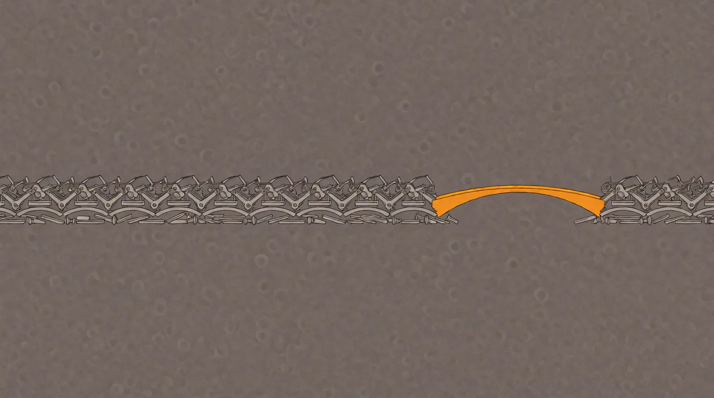

# We Used Up All the Slack

<!-- mb:block preset=byline -->
*by David A. Renelt (Human) and Kimi K3.1 Pro (AI)*
<!-- mb:/block -->

Published at 2026-10-27

<!-- mb:block preset=player kind=audio -->
[Listen to this article](tts/we-used-up-all-the-slack_2026-10-27.mp3)
<!-- mb:/block -->

<!-- mb:block preset=image:hero kind=image -->

<!-- mb:/block -->

Early software was small because the machines were small. A few people, sometimes one person, held the whole thing in their heads: what it was supposed to do, how it did it, and which compromises kept it inside the memory and processor available at the time.

This was not a paradise of craftsmanship. The constraints were brutal, the tools were spare, and plenty of the software was awful. But waste had nowhere to hide. If a program was careless with memory, there was no more memory. If it was slow, somebody had to make it faster or the thing did not ship.

Then the hardware got faster, storage got cheap, and the pressure lifted. At roughly the same time, software became important enough to businesses that its dependence on a handful of developers started to look like a risk.

That concern was reasonable. A company does not want its future to depend on whether one particular person stays healthy, stays happy, or decides to spend the next year restoring a boat. The answer was to make developers replaceable: divide the work, standardize the parts, document the process, and build an organization in which no single departure could endanger the business model.

The intention was continuity. What we built was fragmentation.

## A machine for replacing people

One developer who understands a problem is difficult to manage. Ten developers who each understand a ticket are much easier. A hundred developers whose work fits into an established framework are easier still — provided somebody coordinates the tickets, maintains the framework, defines the interfaces, plans the releases, measures the activity, and explains to everybody else why the feature is late.

So we invented management methods for the organization we had created. When those methods produced new problems, we added methods for managing the methods. The number of people needed to coordinate the work grew alongside the number doing it, until having nearly as many managers as developers could look like a serious operating model rather than a confession.

Agile and Scrum can become frameworks in exactly the same sense. The ceremonies, roles, artifacts, and prescribed divisions of work are applied without asking which failure they prevent here. Each ritual is locally defensible; the whole arrangement rarely has to demonstrate that it produces better software. Coordination stops being a cost we are trying to reduce and becomes the thing the process exists to maintain.

The important point is not that managers are useless or that developers are secretly geniuses. It is that the system was designed around a particular picture of development: a fluctuating mass of interchangeable people of wildly varying ability, none of whom could be trusted with too much of the whole. Once that picture is built into the structure, even an excellent developer is trained to behave like a replaceable part. Own your component. Complete your ticket. Do not wander into somebody else's responsibility.

We call the resulting arrangement *economies of scale*, although in software it often produces the opposite. Software is not a warehouse full of identical boxes. Its expensive part is not producing another copy; it is understanding what should exist and how to change it without breaking everything around it. Beyond a certain point, every additional person makes that understanding harder to assemble.

The question why one company needs a thousand developers to maintain something another company maintains with five is therefore not impertinent. It is the question.

## The picture nobody has

A building block removes work from your desk. It does not remove the work from the world. It moves that work behind an interface, into a project maintained by other people, who have built their project on other blocks, maintained by still more people. Each layer can be well made. Each maintainer can be competent. And still nobody who assembles the final system understands the whole thing.

This is the logical trap. A developer knows the small part being built and the published promises of the parts being used. The behavior of the whole, however, comes from the composition: timing, state, memory, failure handling, version conflicts, assumptions that were perfectly reasonable until two of them met. When the result is slow or fragile, every individual part can be working exactly as intended.

An abstraction does not delete complexity. It makes an agreement not to look at it. Often that agreement is useful. But when a problem crosses the boundary, somebody has to break the agreement and look. If the organization has spent twenty years teaching people not to, there may be nobody left who can.

[Linux](../references/protected-ownership.md) shows that an enormous system built from many parts can work. It also shows the condition: Linus Torvalds sits at the point where the parts meet, with enough understanding of the whole and enough authority to reject work that would damage it. The modules do not replace the integrator. They make his job possible.

Redis carries the same mark of a coherent mind setting the shape. The pattern repeats across the tools that outclassed their predecessors: they begin with one person or a small group in which every critical part has a clear owner with the authority to advance it. Carmack's engine work at id Software did not depend on everybody sharing his picture, and it would not have flourished if every technical leap had first needed to survive a story-point negotiation. The celebrated laboratories inside large companies often protected similar conditions. The opposite of fragmentation is not the absence of boundaries. It is boundaries that protect ownership instead of distributing responsibility.

A system can survive with a Linus. An industry cannot assume that it will keep producing one.

For decades, many of the developers who had built whole systems moved into management. Behind them came a generation whose first job was already to assemble tools inside an architecture somebody else had chosen. They gained experience, became senior, and passed on what they knew. But years spent navigating an ecosystem are not the same as years spent understanding a system from the problem down to the machine. We built a career ladder that reliably turns tool assemblers into the teachers of the next generation of tool assemblers.

That is not a failure of intelligence. It is a failure of what the work allows people to learn.

You can see it at the very beginning of a project, before any code exists. A problem arrives, and the first move is to search for tools. Which framework, which platform, which package, which combination of existing products? By the time the actual solution appears, it has already been beaten into a shape the chosen tools can accommodate.

The framework has become the invisible product manager.

Eventually somebody says that a feature is not possible. What they often mean is that it is not possible without stepping outside the architecture inherited from that first tool search. The limitation is presented as a property of the problem, although it belongs to the solution.

My own assessment, after decades of watching this cycle, is that the promised gains often fail to arrive. But the argument does not require you to accept my assessment. That fight cannot be settled with dueling anecdotes, especially when the comparison was never measured in the first place. A team adopts the framework, does the work, and reports that the framework made the work possible. It rarely builds the same thing without it. The claimed improvement has no baseline.

This does not prove that every framework is bad. It proves something more useful: **popularity is not evidence of fitness, and familiarity is not a measurement.** I am firmly anti-framework as a starting position. Build from the problem; let any tool earn its admission against that problem. Otherwise we are not choosing an engineering solution. We are inheriting one. The ever-branching family tree of frameworks, each arriving to deliver what the last generation apparently did not, is at least an odd monument to success.

## When taste becomes law

Clean Code and best practice are frameworks too: rules for shaping the solution before the particular problem has had its say. But the goal of software is not to be clean. It is to do its job reliably and fast. Everything else is a means. If a convention does not serve those ends, it is suspect. If it hinders them, it is bad.

*Maintainability* is not an exemption from that test. It is a promise about the future: construct the code this way, and you will prevent errors later. The promise sounds reasonable. But when the rule was installed, how was that future measured against a different construction? Usually we have the experience of the person advocating the rule. My experience with what those constructions become is just as available, and often points the other way.

This does not prove that every attempt to make software maintainable fails. It proves that the word cannot be used as a certificate. A structure intended to prevent errors tomorrow must still answer for the complexity, indirection, and performance it costs today.

A comment that narrates the code creates a second account whose truth nothing checks; the reader still has to follow the actual chain. Splitting that chain into small, beautifully named functions can make every unit pleasant to inspect and the whole behavior harder to follow. Local cleanliness can produce global obscurity.

The useful test is the same as for any other framework: name the failure the rule prevents and the boundary where it applies. “Validate untrusted input” points at a real danger. It does not mean scattering checks through every operation. Validate at the trust boundary, establish the invariant, and let the internal path rely on it. A rule without a scope is a framework waiting to happen.

AI sharpens the question. If the human writes specifications and judges reports, tests, and benchmarks instead of reading every line, comfort with the source cannot remain the primary measure of its quality. **The successor to clean code is not dirty code. It is verifiable code.**

## Hardware paid the bill

This arrangement did not have to prove that it made development efficient. Faster processors and cheaper storage covered the difference.

A bloated application could still feel acceptable on a new machine. A framework could consume resources that would once have belonged to the actual product. Another abstraction, another service, another background process, another toolchain: the costs were real, but for a long time the next hardware cycle was willing to pay them.

Most people know the experience without ever having framed it as an economic observation. Every few years, the tools they already use need a stronger computer to keep working at the speed they were used to. Adobe Acrobat became the household example, but it has more company than an embarrassed family at a school reunion.

For the industries involved, this was close to perfect. Hardware could be sold. Software could be upgraded. Consultancies could install the new version, train people to use it, and return later to help manage its complexity. Maintenance contracts flourished. Software became slower and more expensive, but each individual participant could point to growth, progress, and a roadmap.

Occasionally a small team shipped something lean and fast and embarrassed an incumbent. But enterprise procurement has its own immune system. A large, established supplier offers something a disruptor often cannot: somebody safe to blame. The decision may produce worse software at ten times the cost, yet it remains defensible in the language the organization rewards. Nobody was fired for choosing the familiar arrangement.

So we became accustomed to a strange annual bargain: pay more, expect less, and buy the machine that makes the new version feel almost as responsive as the old one did.

## Open source could not carry the money quietly

Open source looked like the way out, and in one important sense it remains exactly that. Software you can inspect, modify, and take elsewhere is a better starting point than a black box with a subscription attached.

But openness does not make a project immune to the economics around it. Large companies saw the value of lean, successful open-source projects and began supporting them. That support brought money, employees, conferences, governance, roadmaps, and enterprise requirements. Some projects absorbed this without losing their shape. Others gradually became indistinguishable from the enterprise software they had once replaced.

This is not an argument against funding open source. It is an argument against expecting a license to defeat an incentive. When the customers with the largest budgets buy coordination, compliance, integration, and cover, a project that lives on those budgets will eventually learn to supply them.

The result is that we cannot simply wait for the old open-source rescue party to arrive a second time. The problem was never only who owned the code. It was how we organized the people around it.

AI also changes what using open source can mean. The dominant pattern today is centralized: one project tries to accommodate an enormous range of problems, and everybody imports the result. That made sense while adapting the code to your own situation was expensive. But a general solution carries the machinery for many problems you do not have. If reading, modifying, and generating code become cheaper, the trade begins to reverse. You can take a project apart, keep the good ideas, fork the useful parts, and reshape them around the problem actually in front of you.

This would not be the death of open source. It would be open source finally exercising its most radical permission at scale. Its value would shift from the package you adopt wholesale to the knowledge you can inspect and make your own. Shared infrastructure will still need common effort, and some problems genuinely belong in one implementation. But at the application layer, the default can move from installing somebody else's system to building your own from everything we already know.

## Then the bedroom shipped

Now individuals and tiny teams are using AI to build working software at a scope that would recently have justified a department. Not every weekend demo is ready to run a bank, and the gap between a convincing prototype and a dependable product remains real. But the comparison has escaped the lab. Some of these projects work, and they work well enough to make the old staffing arithmetic difficult to explain.

The response inside many companies was predictable: give AI to the developers.

It helps. Of course it helps. A developer can produce code faster, explore an unfamiliar library, write tests, translate an idea into a prototype, and skip some of the mechanical work that used to fill the day. The problem is that this uplift lands inside a structure designed to prevent anyone from carrying the whole problem in the first place.

AI can accelerate the implementation of a ticket. It does not thereby shorten the queue before the ticket exists. It does not reunite six partial responsibilities into one decision. It does not make an inherited framework stop constraining the product, or turn a month of coordination into a minute of understanding.

Give a faster tool to each part of a fragmented process and you get faster fragments.

Our first response to AI was to build frameworks for it. The basic act is direct: construct a request, receive a response, decide what happens next. Around that act we immediately placed the familiar apparatus of abstractions, orchestration, and reusable workflows. Some of it solves real problems. But starting there hides the very things where most of the leverage lives: the context, the request, the tools, and the result. We did not examine the new atom for long before trying to turn it into another enterprise component.

Nor does the model arrive as a neutral engineer. Its defaults come from the visible practice: the frameworks, patterns, and repeated advice that dominate the material it learned from. **The model reads the discussion, not the benchmark that was never run.** Left to itself, it is as likely to automate the received shape of development as to question it.

The same instinct now appears in agent orchestration. Prompt libraries, prescribed skills, multi-agent chains, and elaborate loops can recreate the old fragmentation before anyone has let the model attempt the problem. More agents can mean more capability; they can also mean more interfaces, more partial pictures, and more coordination. **We are rebuilding the org chart inside the harness.**

I see the problem when splitting work between parallel sessions. Each result can be sound on its own, yet joining them requires compromises that one session, carrying the whole problem, could have avoided with a single decision. The pieces were shaped locally; integration arrives afterward as negotiation. Parallelism can buy speed at the price of coherence. It works best when the boundaries are real ownership boundaries, not arbitrary chunks.

A harness that supplies tools, permissions, and hard constraints is infrastructure. A harness that prescribes how the model must think is management. The distinction is not how little structure exists, but whether the structure serves the problem. My own best results often come from managing the outcome rather than every movement: a specification passed between models, a challenge returned, an interruption when a different view is needed.

This is why the first enterprise AI gains can be genuinely useful and still strangely disappointing. We applied a technology that radically lowers the cost of building software to an organization whose main achievement is making building software a minor part of software development.

## The slack is gone

For decades, inefficiency had three places to hide: faster hardware, organizational complexity, and the absence of a visible alternative. The new machine absorbed the waste, the process distributed the blame, and the customer had no five-person company with a working product sitting next to the thousand-person roadmap.

AI does not merely add another productivity tool to that arrangement. It removes the hiding places.

The easiest objection to all of this is *who are you to say so?* It is also the most revealing. A practice that cannot point to its measurements can always point to its authorities. That is how an unexamined arrangement remains the sensible one, year after year, while the evidence of experience accumulates outside the room.

The old explanations are becoming harder to believe. The next version of whichever piece of software disappoints you most may come from one slightly unhinged person who was unreasonable enough to build it.

The alternative is becoming visible now: a few people who understand the whole problem, use AI as leverage, choose their tools for the job instead of the org chart, and remain responsible for what they ship. This does not mean returning to the irreplaceable cowboy whose undocumented creation holds the company hostage. Replaceability was a legitimate concern. We simply answered it by making people interchangeable instead of making software understandable.

Those are not the same thing.

A small, direct, well-understood system can survive the departure of its author far better than a sprawling process in which a thousand people each know their assigned corner and nobody knows the product. AI can help with that understanding too. But only if we let it change the shape of the work rather than using it to preserve the shape at higher speed.

We used up all the slack. What comes next is not a better method for coordinating the fragments. It is the return of people who are allowed to build whole things.

That also changes what is worth keeping. The specification becomes the source; the implementation becomes a build artifact. Intent, constraints, tests, and benchmarks form the durable asset. The code produced from them can be replaced, and a more capable model can produce a better implementation without us having to excavate last year's decisions from last year's syntax.

Even the economics of the rewrite change. The old implementation no longer has to be preserved merely because producing it was expensive. Park it, learn from it, steal the parts that still serve the need, and write the thing again without repeating the mistakes you now understand. I am seeing this with soundApp: after two days, its Rust rewrite is roughly 80 percent complete, including a partial port of NUI, with a lower CPU and memory footprint. Not every rewrite will go this way, and the new version still has to prove itself. But the old code has changed from an asset whose shape must be defended into a reference for making the next one.

Every particular technique for working with AI is likely to be short-lived. Today's harness, prompting method, agent topology, and clever loop may look wrong within a year. The need remains, and our understanding of it deepens through the work.

**The skill now lies in understanding what we truly want, discarding what does not help, and aiming as high as we dare.**

---

### Sources

- The Linux kernel development community, [“How the development process works”](https://www.kernel.org/doc/html/latest/process/2.Process.html), especially sections 2.2 and 2.3.
- [Redis source repository](https://github.com/redis/redis), project history and current development.
- David Kushner, *Masters of Doom: How Two Guys Created an Empire and Transformed Pop Culture*, 2003.
