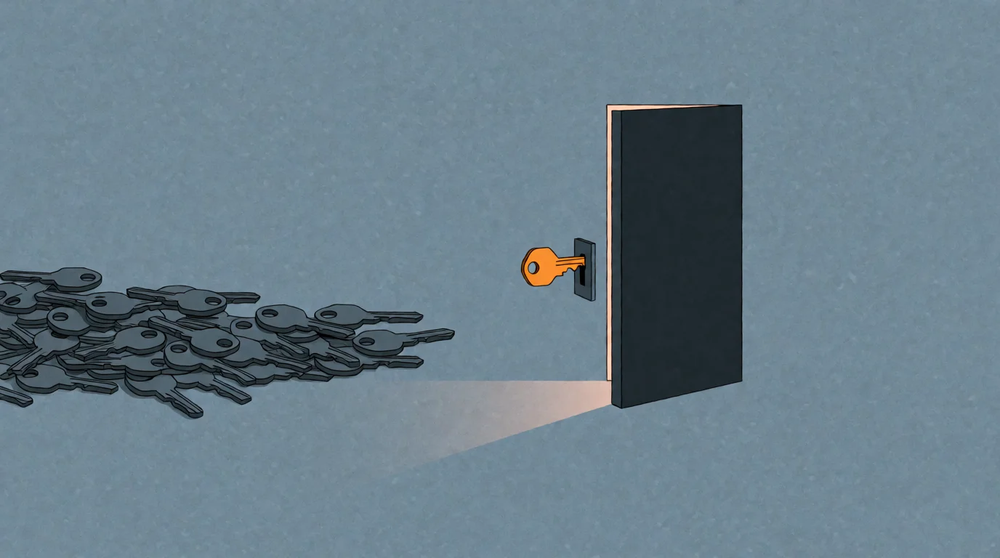

# Wenn Code nicht mehr das Produkt ist

<!-- mb:block preset=byline -->
*by David A. Renelt (Human) and Kimi K3.1 Pro (AI)*
<!-- mb:/block -->

Veröffentlicht am 30. Oktober 2026

<!-- mb:block preset=player kind=audio -->
[Diesen Artikel anhören](tts/when-code-is-no-longer-the-product_de_2026-10-30.mp3)
<!-- mb:/block -->

<!-- mb:block preset=image:hero kind=image -->

<!-- mb:/block -->

*Eine Wette auf Entwicklung als Dienstleistung*

Ich baue leidenschaftlich gern Dinge. Für jemanden mit dieser Eigenart ist brauchbare künstliche Intelligenz vor allem eines: ein wahr gewordener Traum. Ich kann mehr bauen, besser bauen und dem Ergebnis dabei zusehen, wie es in einem Tempo Gestalt annimmt, das vor wenigen Jahren noch nach Prahlerei geklungen hätte. Ich tue das in erster Linie für mich selbst, während mein Angestelltenverhältnis die nötige Freiheit dafür finanziert.

Ich rechne nicht damit, dass mein Arbeitsplatz morgen verschwindet. Große Unternehmen sterben langsam, und meines wird mich vermutlich bis zum Ruhestand überleben. Wenn ich mich allerdings mit anderen Entwicklern unterhalte, schlägt mir aus diesen Gesprächen eine Verzweiflung entgegen, die sich immer schwerer hinter Galgenhumor verbergen lässt.

Da steht eine Frage im Raum, deren Beantwortung wehtut: Waren die Jahrzehnte, die man investiert hat, um programmieren zu lernen und sich darin zu verbessern, am Ende wertlos?

Für manchen vielleicht, für die meisten nicht. Der Unterschied liegt in einer Verwechslung, an der sich die Branche jahrelang beteiligt hat: dem Unterschied zwischen dem bloßen Erzeugen von Code und der mühsam erworbenen Urteilskraft. Das Wesentliche am Entwickeln war nie das Eintippen von Syntax, sondern das Verstehen des eigentlichen Problems. Dazu gehören die Fähigkeit, einen faulen Entwurf zu erkennen, Ausfälle im Geist vorwegzunehmen und zu prüfen, ob ein Gebilde in der Wirklichkeit auch dann noch standhält, wenn niemand hinsieht. Unzählige Entwickler haben genau dieses Gespür erworben, obwohl die Organisationen um sie herum alles daransetzten, sie auf das Abarbeiten von Tickets zu reduzieren. Bezahlt wurde die Implementierung; die Urteilskraft kam unbemerkt mit.

## Wenn Implementierung billig wird

Wenn die reine Implementierung durch Modelle im Überfluss verfügbar wird, stellt sich unweigerlich die Frage, worin der Wert von Entwicklung künftig noch bestehen kann. Ich beanspruche hier keine fertige Antwort, denn die wirtschaftlichen Auswirkungen von KI haben gerade erst begonnen. Wer heute eine vollständige Landkarte der kommenden Dekade aus der Tasche zieht, verwechselt Wunschdenken mit Weitsicht. Einige Konsequenzen lassen sich dennoch nüchtern ableiten.

Code behält seinen Nutzen, aber er verliert seine Knappheit – und was nicht mehr knapp ist, taugt kaum noch als Fundament für ein Geschäftsmodell. Software war schließlich nie Selbstzweck, auch wenn wir uns zeitweise so verhalten haben. Sie diente schon immer Zielen außerhalb ihrer eigenen Textdateien: Waren produzieren, Dienstleistungen erbringen, kommunizieren, entwerfen oder unterhalten. Eine Industrie kann nicht auf Dauer davon leben, dass eine Schicht aus Abstraktionen immer neue Schichten an die nächste Abteilung verkauft. Wenn Implementierung reichlich wird, muss jede dieser Schichten wieder eine einfache Frage beantworten: Welches Ergebnis jenseits der Software machst du eigentlich möglich?

Dass dieser Wandel keine ferne Theorie ist, zeigt [ArtCraft](../references/artcraft_de.md). Ein kleines Team hat mithilfe von KI quelloffene Anwendungen gebaut, die das sichtbare Verhalten etablierter Adobe-Werkzeuge und öffentliche Dateiformat-Spezifikationen nachbilden. Dabei wurde nach den Angaben des Teams kein proprietärer Quelltext kopiert. Die Programme befinden sich noch im Alpha-Stadium und sind kein fertiger Ersatz für die Adobe-Produkte. Aber die Stoßrichtung ist unmissverständlich: Eine lange Liste von Programmfunktionen samt ihrer technischen Umsetzung wird reproduzierbar. Der Code verrichtet weiterhin seine Arbeit, taugt aber nicht mehr als tiefer Burggraben, hinter dem sich ein Unternehmen bequem einrichten kann.

Der wirtschaftliche Wert wandert zu dem, was jemand mit der Software tatsächlich tun kann: wie sie zu Dateien, Hardware, Gewohnheiten und realer Arbeit passt. Der Wettbewerb wird zu einer Ökonomie der Passung.

## Entwicklung als Dienstleistung

Daraus ergibt sich eine Wette, die das Selbstverständnis unseres Berufsstands verschiebt: Entwicklung wird zu einer Dienstleistung. Es geht nicht mehr darum, Quelltexte wie Tafelsilber zu hüten und den bloßen Besitz von Software zu veräußern, sondern darum, ein System in der widerspenstigen Wirklichkeit anderer Menschen verlässlich zum Laufen zu bringen.

Dienstleistung meint hier ausdrücklich nicht das alte Spiel, bei dem man Stundenkontingente unter dem Deckmantel der Beratung abrechnet. Verkauft wird keine Anwesenheit, sondern eine funktionierende Fähigkeit.

Man sieht das an einem Produkt für Retrieval-Augmented Generation. Es kann Dokumentenaufnahme, eine Chat-Oberfläche, eine API und lokale Laufzeitumgebungen für Embeddings und Inferenz mitbringen. Das ist nützliche Maschinerie, aber noch kein funktionierendes RAG-System für einen bestimmten Kunden. Die eigentliche Arbeit beginnt dort, wo die Demo aufhört: echte Dokumente und bestehende Systeme einbinden, Berechtigungen abbilden, die vorhandene Hardware berücksichtigen und das System weiterpflegen, wenn sich die Umgebung verändert. Das Produkt liefert Teile und Zusammenbau; die Entwicklung liefert das Ergebnis.

Noch deutlicher wird diese Trennung in der physischen Automatisierung. Ein Modell erzeugt Steuerungslogik in Sekundenbruchteilen, doch dieser Code ist lediglich der Anfang. Jemand muss die physischen Abläufe begreifen, Maschinen und Sensoren verbinden, Grenzfälle berücksichtigen und dafür geradestehen, dass die Anlage sicher und verlässlich arbeitet. Das eigentliche Ergebnis ist keine hübsche Codebasis, sondern ein gefertigtes Werkstück, ein ankommendes Paket oder eine Maschine, die stoppt, wenn sie stoppen muss. Die raue Wirklichkeit lässt sich von elegant formatierten Repositories herzlich wenig beeindrucken.

Nun wäre es naiv, die Integration von Systemen für eine uneinnehmbare Festung zu halten, auf der sich Entwickler für alle Zeiten ausruhen können. KI wird auch dort erhebliche Teile automatisieren. Meine Wette lautet deshalb nicht, dass die Handarbeit an Schnittstellen ewig währt. Sie lautet: Die Werteinheit wandert von der Implementierung zum Ergebnis. Wer Verantwortung für ein funktionierendes Ganzes übernehmen kann, hat auch morgen etwas Wertvolles anzubieten.

## Die Maschinerie des Handelns

Entwicklung dient zunehmend dem, was mit KI möglich wird: Wir benutzen sie zum Bauen und errichten gleichzeitig die Maschinerie, durch die sie handeln kann. Dafür wird weiterhin viel Software benötigt. Ihr Zweck besteht jedoch immer öfter darin, KI in der Welt handeln zu lassen.

Das bedeutet mehr, als bestehende Abläufe besser zu verwalten. Es bedeutet, menschliche Arbeit durch Maschinen zu ersetzen, wo Maschinen die Arbeit erledigen können: dasselbe oder mehr mit weniger menschlichen Arbeitsstunden zu erzeugen. Für die Betroffenen ist das unbequem, und die gesellschaftlichen Folgen müssen ernsthaft behandelt werden. Sie sind aber nicht Gegenstand dieses Artikels, und an der Unausweichlichkeit dieser Entwicklung ändern sie nichts. Unser Thema hier ist eine Vision für Entwickler.

Für Entwickler folgt daraus eine direkte Konsequenz: Definiere die Arbeit nicht als Codeproduktion, sondern als das Herbeiführen eines Ergebnisses. Code ist ein wichtiger Teil der Maschinerie, aber nicht ihr Zweck.

## Wo das Produkt bleibt

Produkte verschwinden deshalb nicht. Ein gutes Produkt liefert Teile und einen stimmigen Zusammenbau. Entwicklung macht diesen Zusammenbau in einer bestimmten Umgebung nützlich und hält ihn bei Veränderungen tauglich.

Die einzelnen Bausteine können dabei quelloffen sein. Öffentliche Repositories lassen sich als Wissensbibliotheken behandeln: prüfen, was andere gebaut haben, tragfähige Ideen entnehmen, an die eigenen Bedürfnisse anpassen, verbessern und eigene Erkenntnisse so zurückgeben, dass andere daraus lernen können. Zusammenbau und Benutzeroberfläche dürfen geschlossen bleiben, wenn das Geschäftsmodell diese Grenze braucht. Nur sollte man sich nicht hinter dem Geheimnis des Quellcodes verschanzen, wenn Rekonstruktionen durch KI immer billiger werden.

**Das Geschäft ist nicht Geheimhaltung, sondern die Bereitschaft, für ein funktionierendes System einzustehen.**

Diese Verantwortung muss im Produkt sichtbar werden. Entwicklung muss schnell genug sein, damit das Angebot kontinuierlich besser werden kann. Besser heißt dabei nicht bloß mehr Funktionen, sondern verlässlicher, schneller bei geringerem Ressourcenverbrauch und einfacher zu benutzen. Ein kleines Team kann einen Riesen nicht mit Geld schlagen, aber mit besserer Passung zur Arbeit und schneller Verbesserung ohne lange Genehmigungswege.

Was meine eigene Arbeitsweise angeht, halte ich es seit jeher mit einer Schlichtheit, die älter ist als die aktuellen Sprachmodelle: Ich baue Systeme so direkt und begreifbar wie möglich, verzichte auf Frameworks und Utility-Bibliotheken als Standard und hole fremde Abhängigkeiten nur dann ins Haus, wenn es um echte Infrastruktur geht oder mir die nötige Expertise fehlt. Open Source ist dabei Wissensquelle, kein Ersatz für eigenes Denken. Als Sprache dient mir das unterste Werkzeug, dessen Ergebnisse ich noch verlässlich prüfen kann – derzeit meistens Rust. Ich ziehe schmale APIs spekulativen Abstraktionen vor, Werkzeuge und harte Grenzen vorschreibenden KI-Harnesses und klare Verantwortung zusätzlicher Koordination. Diese Grundsätze sind keine Dogmen. Sie helfen lediglich, Software veränderbar und ressourcenschonend zu halten, damit eine Person oder ein kleines Team das Ganze noch tragen kann.

Wir müssen uns also weder einreden, dass Programmcode über Nacht wertlos wird, noch darauf hoffen, dass uns die reine Integrationsarbeit bis an unser Lebensende ernährt. Der Kern der Wette bleibt: Wenn Implementierung im Überfluss vorhanden ist, bleiben Ergebnisse wertvoll.

Bauen wir die nötige Maschinerie. Teilen wir das gewonnene Wissen. Bieten wir verlässliche Fähigkeiten an – und stehen wir für das ein, was als Nächstes geschieht.

---

### Quellen

- [PhotoCraft-Quellrepository und Projektdokumentation](https://github.com/storytold/photocraft), einschließlich der Beschreibung des Clean-Room-Vorgehens und des frühen Alpha-Status.
- Ars Technica, [*„Software is over“: Bold AI developer takes aim at Adobe with open source clones*](https://arstechnica.com/ai/2026/10/software-is-over-bold-ai-developer-takes-aim-at-adobe-with-open-source-clones/), Oktober 2026.
