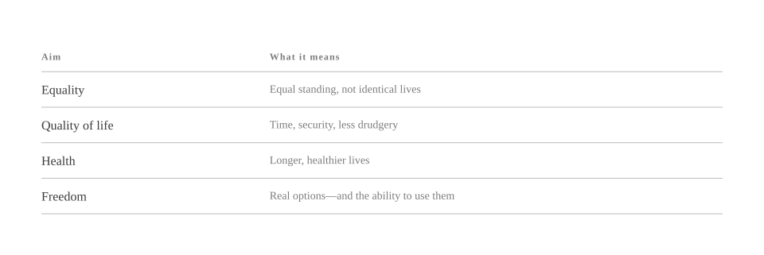
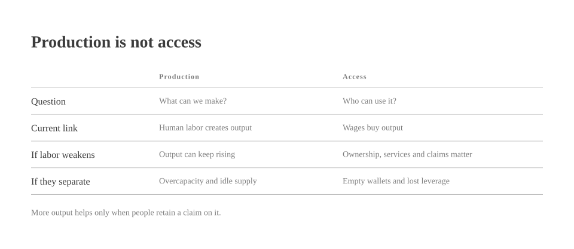
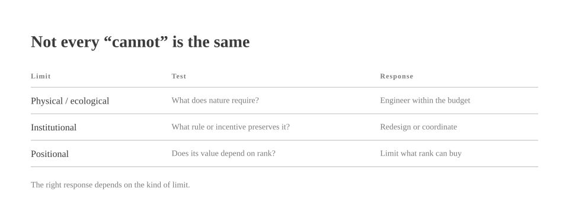

# Why the Fuck Not?

*by David A. Renelt (Human) and Kimi K3.1 Pro (AI)*

<!-- mb:block preset=player kind=audio -->
[Listen to this article](tts/why-the-fuck-not_2026-11-08.mp3)
<!-- mb:/block -->

<!-- mb:block preset=image:hero kind=image -->

<!-- mb:/block -->

**Let's aim big.**

Equality. Quality of life. Health. Freedom.

Not as the polite residue left over after growth, but as the point of the exercise. Why the fuck not?

<!-- mb:block preset=image kind=image -->

<!-- mb:/block -->

These are not four independent boxes. By equality I mean equal standing, not identical lives; by freedom, real options and the practical ability to use them. Equality without freedom can become enforced uniformity. Freedom without equality becomes privilege. Health and quality of life give both a body.

AI—or superintelligence, for those who prefer the larger label—opens possibilities that until recently belonged to speculation. Nearly everyone agrees on that part. Yet possibility arrives without an address. It does not tell us whose life will improve, who will own the new capacity, or who will be left with a cheaper subscription and no income.

For whom is all this capability supposed to be?

The answer is often left blank, perhaps by choice. Naming an aim would force us to examine who benefits now, who stands to lose, and whether the people building the future have any intention of sharing it. It is much more comfortable to talk about transformation in the abstract and let the existing distribution of power fill in the details.

I would rather not leave that part to the default settings.

The age of AI can go wrong in horrifying ways: cheaper surveillance, manipulation, coercion, and war; more capability paired with less freedom. If we do not aim at something good, we are not choosing a neutral future. We are simply delegating the aims to whoever already holds the levers.

The objections arrive on schedule: we cannot afford it. Sometimes that is true. Energy, labor, materials, time, and ecological capacity are real constraints. But “we cannot” is a wonderfully versatile phrase. It can describe a law of physics, an empty treasury, a property regime, or the fact that somebody quite likes the current arrangement. These are very different problems, and only the first cannot be wished away.

## The ticket to the output

Productivity growth is old news. The potentially new threshold is [broad substitution across cognitive work](../references/production-access-labor-leverage.md), perhaps followed by wider physical automation, until output can keep rising while economically valuable human labor becomes much less necessary.

That has not happened across the whole economy, and I do not know whether it will. Automation also complements workers and creates new tasks. Still, the possibility matters because our present arrangement rests on a quiet dependency: most people receive their share of the output by selling their labor.

If that mechanism weakens, cheaper goods alone do not settle the matter. A lower price is of limited comfort to an empty wallet.

**Production and access are different problems. An economy can develop the capacity to solve the first while failing at the second.**

<!-- mb:block preset=image kind=image -->

<!-- mb:/block -->

Access is not a moral ornament bolted onto the side of production. A market requires customers. If output expands while purchasing power drains away, the economy does not become a glorious abundance machine with an unfortunate blind spot. It gets full warehouses, idle capacity, and a political crisis.

The deeper problem is power. **Labor has supplied bargaining power as well as income.** If production requires much less human effort, appeals to everyone's better nature will not fill the gap. Ownership, democratic rights, public services, and enforceable claims on output have to be built while the transition is still negotiable.

## Show me the limit

Whenever somebody explains why a better arrangement is impossible, the obstacle ought to pass through a small customs inspection. Is it physical, institutional, or positional? “We cannot” crosses the border between these categories with suspiciously little paperwork.

A physical limit can be worked with, within reason. An institutional limit can be redesigned, with effort and friction. A positional limit cannot be abolished by producing more: not everyone can be above average, exclusive, or in command. Yet we can still decide what being above average is allowed to buy.

None of this means institutions change because we glare at them. Capital moves, states compete, and one government acting alone may fail where a coordinated bloc could succeed. “Just change the system” is a slogan, not a policy. It marks where the work begins, not where it ends.

[The distinction matters](../references/physical-institutional-positional-limits.md) because each kind of limit calls for a different instrument: engineering, institutional redesign, international coordination, or a firm refusal to let social rank determine who gets medicine. Calling every obstacle “realism” merely spares us the trouble of reaching for the right tool.

<!-- mb:block preset=image kind=image -->

<!-- mb:/block -->

AI has to pass through the same inspection. Behind the weightless interface sit data centers, fabs, power grids, cooling towers, and mineral supply chains. It is heavy industry with a text box. The International Energy Agency estimated that [data centers consumed about 415 TWh in 2024](../references/ai-energy-budget.md), with demand projected to more than double by 2030 in its Base Case. Those figures cover all data centers, not AI alone, which is still more than enough to ruin the pleasant fiction that computation happens in a cloud without weather.

This does not sink the ambition; it specifies the bill of materials. It means clean energy, grid infrastructure, more efficient computation, and hard ecological budgets. If the impact per service falls tenfold while total use rises twentyfold, total impact still doubles. The efficiency chart looks triumphant while the atmosphere gets worse—the sort of improvement we should learn to spot from a greater distance.

**Show me the physical constraint. Show me the ecological budget. Show me the unavoidable trade-off. If none exists, do not call the preservation of deprivation “realism.”**

## The rich can get richer

A standard objection is that the wealthy will never allow a fairer arrangement. Some will not. Still, it is worth being precise about what they would actually be defending.

[You can get rich by making other people's lives better](../references/progress-wealth-power.md). Better medicine, cheaper clean energy, stronger education, and more capable tools create genuine value. Any workable transition will need builders, ambition, and risk-taking. Declaring war on success itself would be spectacularly counterproductive, above all for the people in whose name the war was declared.

Yet wealth creation and wealth capture are distinct trades. Rent extraction and monopoly also produce fortunes. A positive-sum economy is possible, not self-enforcing.

And then there is the problem that growth alone cannot dissolve. Health, security, time, and freedom can be shared without losing their value. Status and command over others are positional. If wealth means living well, other people's progress takes nothing from the table. If wealth means living in a way others cannot, universal improvement registers as a personal injury.

**Luxury can remain luxury. What needs limits is domination.**

Wanting a good life is not a moral defect. Needing other people to lack one is harder to defend.

## What the multiplier is for

Equality, quality of life, health, and freedom are easy to applaud at a conference and expensive to mean on a Tuesday. That is why serious people so often lower their gaze and return to the quarterly targets.

Yet why should the quarterly target have a monopoly on seriousness?

They are vague only if we leave them floating in the abstract. Here they have a test: does a person have standing, a real choice, a healthy life, and the time and security to live it? No law of physics decrees that these material preconditions must remain scarce.

<!-- mb:block preset=card -->
**The point of a 10x society is not ten times as much stuff. It is that fewer lives are constrained by deprivation, exhaustion, and preventable illness. The goal is not to make humanity redundant. It is to make human dignity less conditional.**
<!-- mb:/block -->

So the next time someone explains why people must remain insecure, exhausted, or untreated, ask to see the ledger rather than the raised eyebrow. If the constraint is physical, let us engineer. If it is institutional, let us redesign. If it is a coordination problem, let us coordinate. And if it turns out to be privilege dressed up as fate, let us at least stop calling it inevitable.

**We are discussing a choice about power and access.**

Arrangements like that do not yield because an essay asks politely. They shift when people organize, build working alternatives, and make the old settlement too costly to maintain. Still, they remain choices.

Why the fuck not?

## Sources

- International Energy Agency, [*Energy and AI*](https://www.iea.org/reports/energy-and-ai) (April 2025).
