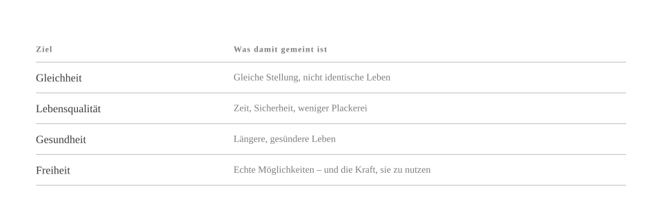
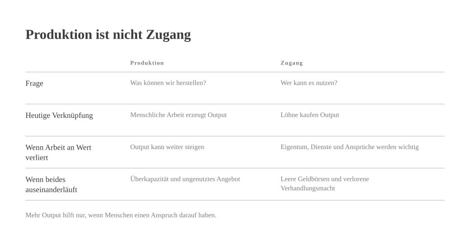
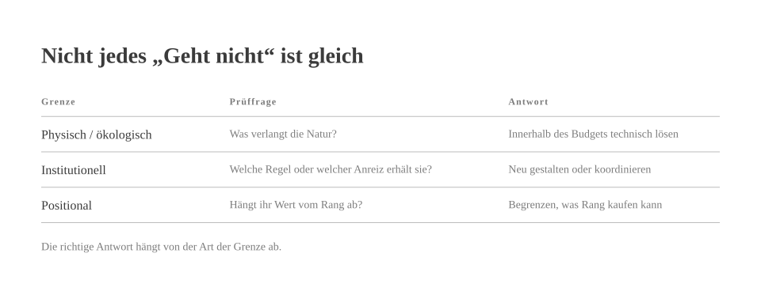

# Why the Fuck Not?

*by David A. Renelt (Human) and Kimi K3.1 Pro (AI)*

<!-- mb:block preset=player kind=audio -->
[Diesen Artikel anhören](tts/why-the-fuck-not_de_2026-11-08.mp3)
<!-- mb:/block -->

<!-- mb:block preset=image:hero kind=image -->

<!-- mb:/block -->

Fangen wir ausnahmsweise mal nicht bei der Maschine an, sondern bei der Frage, wozu der ganze Aufwand überhaupt gut sein soll. Wenn wir schon dabei sind, den Maschinenraum der menschlichen Vernunft neu zu verkabeln, dann sollten am Ende vier Dinge herausspringen: Gleichheit, Lebensqualität, Gesundheit und Freiheit. Und zwar nicht als freundliches Dessert, falls nach dem nächsten Wachstumsquartal noch ein paar Krümel übrig sind, sondern als eigentlicher Sinn der Veranstaltung. Wem dieser Anspruch in einem Zeitalter kleinkarierter Machbarkeitsstudien etwas unverschämt vorkommt, dem lässt sich eigentlich nur mit einer Gegenfrage antworten: *Why the fuck not?*

<!-- mb:block preset=image kind=image -->

<!-- mb:/block -->

Diese vier Begriffe sind weder getrennte Schubladen noch dekorative Vokabeln für Sonntagsreden, die man nach dem Applaus wieder ordentlich zusammenfaltet. Gleichheit heißt gleiche Augenhöhe unter Menschen, nicht identische Lebensläufe im Einheitslook. Freiheit heißt, echte Möglichkeiten zu haben – und die praktische Kraft, sie auch zu nutzen. Nimmt man das eine ohne das andere, kippt Gleichheit schnell in graue Gleichmacherei, während Freiheit ohne gleiche Augenhöhe schlicht unter ihrem älteren Künstlernamen auftritt: Privileg. Lebensqualität wiederum bemisst sich an freier Zeit, verlässlicher Sicherheit und dem Ende sinnloser Plackerei; Gesundheit an längeren, besseren Jahren und dem Zugang zu einer Versorgung, die nicht erst nach dem Geldbeutel fragt.

Dass künstliche Intelligenz – und erst recht eine künftige Superintelligenz – unsere Möglichkeiten gewaltig ausweiten dürfte, bestreitet inzwischen kaum noch jemand. Verdächtig still wird es im Saal erst bei der Anschlussfrage, wem dieser neue Zauberkasten gehören und wem er nützen soll. Oft bleibt diese Stelle leer, vielleicht absichtlich. Denn wer das Ziel nicht beim Namen nennt, drückt sich elegant um zwei unangenehme Auskünfte: wer schon heute die Zeche zahlt und ob die Bauherren der schönen neuen Welt überhaupt vorhaben, deren Erträge zu teilen.

Dabei kann dieses Zeitalter auf ganz unspektakulär entsetzliche Weise gegen die Wand fahren. Überwachung, Manipulation, Zwang und Kriegführung werden durch fähigere Systeme schließlich nicht teurer, sondern billiger; eine Gesellschaft kann spielend leicht an technischer Schlagkraft zulegen und im selben Atemzug ihre Freiheit verspielen. Wer vor dieser Kulisse so tut, als sei der Verzicht auf ein gutes Ziel ein Gebot kühler Neutralität, ist überhaupt nicht neutral. Er überlässt die Hausordnung einfach denen, die ohnehin schon den Schlüsselbund am Gürtel tragen.

## Wenn die Arbeit den Lohn verlässt

Steigende Produktivität ist an sich ein alter Hut. Neu wäre erst der Punkt, an dem Maschinen [kognitive Arbeit in der Breite ersetzen](../references/production-access-labor-leverage_de.md) – und eines Tages vielleicht auch einen großen Teil der körperlichen. Dann könnte der gesellschaftliche Ausstoß munter weiterwachsen, während menschliche Arbeitskraft als wirtschaftlich gefragte Ware allmählich an Bedeutung verliert.

In Stein gemeißelt ist dieses Drehbuch natürlich nicht. Oft genug greift uns Automatisierung eher unter die Arme, statt uns vor die Tür zu setzen, und erfindet nebenbei völlig neue Berufe. Trotzdem wäre es ziemlich leichtsinnig, sich mit dieser Beruhigungspille wieder schlafen zu legen. Denn unser heutiges System hängt an einem denkbar schlichten Scharnier: Die meisten Menschen kommen an ihren Teil vom Kuchen nur heran, indem sie ihre Arbeitszeit verkaufen. Leiert dieses Scharnier aus, regelt sich der Rest keineswegs von selbst über sinkende Preise. Auch das billigste Schaufenster tröstet ein leeres Konto nur in sehr engen Grenzen.

**Produktion und Zugang sind zwei verschiedene Probleme. Eine Wirtschaft kann die glänzendsten Mittel zur Lösung des ersten entwickeln und am zweiten krachend scheitern.**

<!-- mb:block preset=image kind=image -->

<!-- mb:/block -->

Dazu kommt eine eiserne Banalität, um die selbst das frömmste Marktmodell nicht herumkommt: Irgendwer muss das ganze Zeug auch kaufen. Wenn die Fabriken brummen, während die Kaufkraft der Vielen verdunstet, landen wir nicht im Schlaraffenland, sondern vor vollen Lagerhallen, stillstehenden Bändern und einer ausgewachsenen politischen Krise. Verteilung ist deshalb kein moralisches Geschenkbändchen, das man einer funktionierenden Wirtschaft nachträglich um den Bauch bindet, sondern das Schmieröl, ohne das der Motor irgendwann frisst.

Obendrein bringt Arbeit im bisherigen Spiel nicht nur Geld nach Hause, sondern auch ein Druckmittel. Wer gebraucht wird, kann auf den Tisch hauen; wer überflüssig wird, muss auf die gute Laune der Gewinner hoffen – und das war historisch gesehen noch nie eine besonders krisenfeste Rentenversicherung. Wenn menschliche Arbeit als Eintrittskarte an Wert verliert, müssen wir Eigentumsformen, demokratische Rechte, öffentliche Infrastruktur und einklagbare Ansprüche auf den gemeinsamen Ertrag unter Dach und Fach bringen, solange wir am Verhandlungstisch noch eigene Karten in der Hand halten.

## Eine kleine Zollkontrolle für das Unmögliche

Immer wenn jemand mit bedauerndem Schulterzucken erklärt, eine großzügigere Welt sei leider, leider unmöglich, empfiehlt sich eine kleine Zollkontrolle für angebliche Sachzwänge. Der Satz „Das geht halt nicht“ schmuggelt sich nämlich bemerkenswert gern ohne gültige Papiere über drei völlig verschiedene Grenzen.

Da wären zuerst die physischen und ökologischen Grenzen: Energie, Rohstoffe, Zeit, Biologie und ein Planet, der bei den Naturgesetzen keinen Rabatt gibt. Diese Wände sind tatsächlich aus Beton; hier helfen nur Ingenieurskunst, Infrastruktur und ehrliche Kostenrechnungen. Gleich daneben stehen aber die institutionellen Grenzen: Eigentumsregeln, Lohnabhängigkeit, Patente, Berufsregeln oder Marktzugänge. Die bewegen sich zwar oft nur unter lautem politischem Ächzen, sind aber von Menschen gemacht – also Hausordnungen und keine Schwerkraft. Und schließlich gibt es noch die positionalen Grenzen: Rang, Exklusivität und das süße Gefühl, über anderen zu stehen. Natürlich können nicht alle gleichzeitig über dem Durchschnitt liegen, und nicht jeder kann der Chef im Ring sein. Aber man kann sehr wohl darüber reden, wie viel Macht über das Leben anderer man sich für einen höheren Tabellenplatz eigentlich kaufen darf.

Und weil das allein noch nicht knifflig genug ist, schwebt über allem auch noch das [Koordinationsproblem](../references/physical-institutional-positional-limits_de.md). Kapital hat schnelle Schuhe, Staaten konkurrieren miteinander, und eine einzelne Regierung kann mit einer völlig vernünftigen Idee baden gehen, die im gemeinsamen Block problemlos geklappt hätte. „Ändert halt das System“ ist deshalb noch keine Politik, sondern bestenfalls der Arbeitsauftrag auf dem Deckblatt.

<!-- mb:block preset=image kind=image -->

<!-- mb:/block -->

Wie wenig sich die materielle Seite wegdiskutieren lässt, merkt man sofort, wenn man einmal hinter die luftige Fassade heutiger KI-Modelle schaut. Hinter dem höflichen kleinen Eingabefeld im Browser rattern Rechenzentren, Chipfabriken, Stromtrassen, Kühltürme und globale Lieferketten für kritische Mineralien – kurz gesagt: Schwerindustrie mit Chatfenster.

Nach Schätzungen der [Internationalen Energieagentur](../references/ai-energy-budget_de.md) schluckten Rechenzentren weltweit im Jahr 2024 rund 415 Terawattstunden Strom, also etwa anderthalb Prozent des globalen Bedarfs; im Basisszenario von 2025 klettert dieser Wert bis 2030 auf rund 945 Terawattstunden. Darin stecken zwar sämtliche Rechenzentren und nicht nur künstliche Intelligenz, aber die Richtung ist klar: Netzengpässe, knappe Bauteile und ökologische Kosten sind handfeste Größen. Nur beweist ein wachsender Stromhunger noch lange nicht, dass ein gutes Leben für alle ausfällt – er heißt bloß, dass wir beim Umbau den Taschenrechner einschalten müssen.

Auch Effizienzgewinne sind hier leider kein Freifahrtschein. Wenn die Belastung pro Dienstleistung um den Faktor zehn sinkt, die Nutzung im selben Zeitraum aber um das Zwanzigfache zulegt, hat sich die Gesamtbelastung am Ende verdoppelt. Die Effizienzkurve in der Präsentation feiert dann einen triumphalen Sturzflug, während die Atmosphäre draußen trotzdem kräftig nachlegt.

**Wer also „Geht nicht!“ ruft, soll bitte das physikalische Limit, das ökologische Budget und den unvermeidbaren Zielkonflikt auf den Tisch legen. Wo nichts davon vorzuweisen ist, sollte man die kunstvolle Pflege vermeidbarer Knappheit nicht länger als harten Realismus verkaufen.**

## Was der Erfolg des Nachbarn kostet

Nun hat kein vernünftiger Mensch etwas dagegen, dass Leute reich werden, weil sie [das Leben anderer spürbar besser machen](../references/progress-wealth-power_de.md). Bessere Medizin, billigere saubere Energie, klügere Bildung und nützlichere Werkzeuge schaffen echten Wert, und kein Umbau dieser Größenordnung kommt ohne Macher, Kapital, Fachwissen und den Mut zum Risiko aus. Ein blinder Kreuzzug gegen den Erfolg an sich würde am Ende garantiert zuerst denen auf die Füße fallen, in deren Namen man ihn vom Zaun bricht.

Nur fällt ein volles Bankkonto leider nicht automatisch vom Himmel, weil man der Menschheit einen Dienst erwiesen hat. Man kann genauso gut prächtig daran verdienen, wegelagernd Maut zu kassieren, Monopole auszuschlachten oder die eigenen Aufräumkosten elegant der Allgemeinheit vor die Tür zu kippen. Das Positivsummenspiel, bei dem der Gewinn des einen aus dem Nutzen der anderen wächst, ist absolut machbar – es stellt sich nur leider nicht von alleine ein.

Genau hier entscheidet sich auch, was wir unter Wohlstand überhaupt verstehen wollen. Gesundheit, Sicherheit, freie Zeit und eigener Gestaltungsspielraum werden ja keinen Deut schlechter, nur weil die Nachbarn ebenfalls gesund sind und am Wochenende Zeit haben. Status und Herrschaft dagegen funktionieren nur mit Sicherheitsabstand nach unten. Solange Wohlstand einfach ein gutes Leben meint, nimmt der Fortschritt anderer niemandem die Butter vom Brot. Erst wenn man Reichtum darüber definiert, Dinge zu haben, die andere sich ausdrücklich *nicht* leisten können, fühlt sich jede allgemeine Verbesserung plötzlich wie ein Einbruch in die eigene Garage an.

**Luxus darf ruhig Luxus bleiben. Wo eine Grenze eingezogen werden muss, ist bei der Herrschaft.** Der Wunsch nach einem schönen Leben ist kein Charakterfehler; ziemlich schwer zu verteidigen wird es erst, wenn man zur eigenen guten Laune dringend Leute um sich herum braucht, denen es dreckig geht.

## Das Budget hinter der Augenbraue

Natürlich gehen Gleichheit, Lebensqualität, Gesundheit und Freiheit auf einem Podium leicht über die Lippen und wirken an einem normalen Dienstagvormittag sofort verdächtig teuer. Man fragt sich allerdings schon, mit welchem Recht ausgerechnet das nächste Quartalsziel für sich reklamiert, der einzige Erwachsene im Raum zu sein.

Schwammig wirken diese vier Maßstäbe ohnehin nur, solange man sie in der dünnen Höhenluft großer Begriffe schweben lässt. Unten auf dem Teppich ist der Lackmustest denkbar einfach: Begegnen sich Menschen auf Augenhöhe? Haben sie echte Wahlmöglichkeiten, eine robuste Gesundheit sowie genug Zeit und Sicherheit, um ihr eigenes Leben nicht nur zu verwalten, sondern zu führen? Kein Gesetz der Thermodynamik schreibt vor, dass die materiellen Grundlagen dafür künstlich knapp gehalten werden müssen.

<!-- mb:block preset=card -->
**Eine Gesellschaft, die ihre Fähigkeiten verzehnfacht, hat das Thema verfehlt, wenn sie am Ende bloß zehnmal so viel Zeug auftürmt. Der Sinn eines solchen Sprungs bestünde doch darin, dass weniger Biografien an Mangel, Erschöpfung und vermeidbarer Krankheit klein gehalten werden – nicht um den Menschen überflüssig zu machen, sondern damit seine Würde an weniger Bedingungen geknüpft ist.**
<!-- mb:/block -->

Wer dem widersprechen möchte, sollte deshalb schon etwas mehr mitbringen als eine skeptisch hochgezogene Augenbraue. Zeigt das Budget, benennt den Engpass. Physische Grenzen verlangen nach Technik und Ausbau, institutionelle nach besseren Spielregeln, Koordinationsprobleme nach gemeinsamen Bündnissen. Nur das bloße Vorrecht, das sich gern im feinen Zwirn des Schicksals zeigt, sollte man bitte nicht länger mit dem Unvermeidlichen verwechseln.

Am Ende geht es um Macht und um Zugang – und auf beiden Feldern hat sich selten etwas bewegt, bloß weil ein Essay höflich angeklopft hat. Verhältnisse verschieben sich, wenn Menschen sich zusammentun, funktionierende Alternativen auf die Beine stellen und den alten Zustand Schritt für Schritt unhaltbar machen. Die Frage, mit der das Ganze losgeht, ist jedenfalls immer noch dieselbe: *Why the fuck not?*

### Quellen

- Internationale Energieagentur, [*Energy and AI*](https://www.iea.org/reports/energy-and-ai), April 2025.
